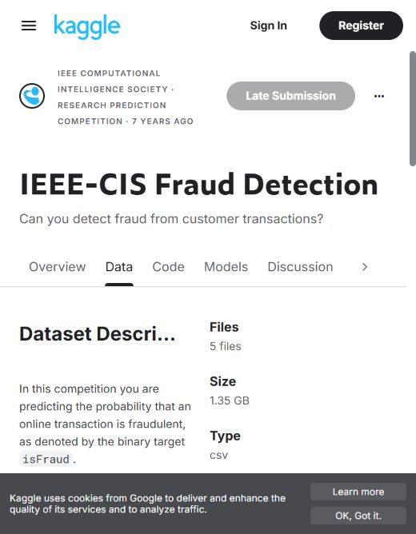

# Build journal and milestone evidence

## October 13, 2026 — delivery workflow updated

Added [the stage-by-stage workflow](DELIVERY_WORKFLOW.md) for stronger model
qualification, lifecycle/monitoring, a temporary AWS assessment and bounded agents.
This is planning work only; no new model training or cloud deployment occurred in
this update. The next implementation is the data/evaluation contract and richer-feature
model comparison.

## Final objective

Build a fraud/risk platform that culminates in bounded investigation agents, after
the data, model lifecycle, workload infrastructure, release, and monitoring foundations.
Agents use LangGraph, scoped MCP tools, and retrieved evidence to produce cited review
packets. Authenticated humans remain authoritative; no autonomous enforcement.

## October 13, 2026 — expanded analysis and local infrastructure proof

Completed full-source descriptive EDA, serving-feature correlations, sampled wider
correlations, three-model temporal comparison, calibration and business-subgroup
analysis. Histogram boosting won selection; a converter failure required a clearly
identified calibrated random-forest deployment fallback. Calibration was not an
improvement in audit Brier score. See [analysis](FULL_EDA_COMPARISON.md).

Proved local Kubernetes deployment, API pod replacement, manual 1-to-3 scaling,
Terraform no-drift and destroy/rebuild, with 60 matching golden predictions.
Removed the disposable cluster afterward. See [proof and reproduction](DEPLOYMENT_PROOF.md).
These supersede the earlier pending infrastructure status below. Agents, external
retrieval/MCP, MLflow/Airflow, monitoring dashboards and AWS serving remain targets.

## October 13 2026 model and API milestone

Trained a new IEEE-CIS numeric random-forest baseline, exported ONNX, checked full
validation prediction parity, and verified ten golden requests through FastAPI.
Focused tests passed: 36 passed, 1 skipped. See [baseline results](BASELINE_MODEL.md)
for reproduction, metrics, limitations, and private artifact locations. Docker engine
started successfully after the initial check. The image built and passed ten golden
predictions over HTTP; the temporary container was stopped. Kubernetes has no configured
local context, and deployment/recovery/scaling proofs remain pending.

## October 11, 2026 — dataset onboarding preparation

**Current stage:** authoritative dataset access and local profiling preparation.

- Saved `scripts/profile_ieee_cis.py`: file checksums, training CSV quality checks,
  missing-cell summaries, identity coverage, fraud rates, and chronological splits.
- Eight synthetic tests passed; repository Ruff and formatting checks passed.
- Actual source data has not been downloaded or analyzed. S3 upload is pending.
- Browser verification shows Kaggle signed out. The AWS tab is also at sign-in.
- GitHub CLI reports expired/invalid authentication; this update is saved locally,
  not yet published. No new cloud resources were started for this step.

This screenshot records an access blocker, not successful ingestion or an EDA result.

## Next milestones and acceptance evidence

### October 11 follow-up — official download and first real EDA completed

Kaggle sign-in and dataset access were verified. Downloaded the official
`ieee-fraud-detection.zip` (123,856,947 bytes) and extracted all five CSV files into
ignored `data/raw/ieee_cis/`. Ran the saved profiler successfully against the real
training transaction and identity tables. Local outputs are in ignored
`artifacts/ieee_cis/run-001/`: `EDA.md`, `eda.json`, and `split_membership.csv`.
The JSON records source checksums, missing-cell counts, coverage, and split statistics.
The private access screenshot is saved under `artifacts/milestones/`.

This supersedes the earlier Kaggle access blocker. It is an initial quality and split
analysis, not completed feature preprocessing or model evaluation. AWS still requires
sign-in; S3 upload is not complete. GitHub publication also remains pending authentication.

1. Access official IEEE-CIS source under accepted terms; record checksums and private
   S3 object versions. Save an upload summary without account identifiers or raw rows.
2. Run real EDA, preserve reproducible outputs, and implement training-only preprocessing.
   Publish aggregate findings and limitations only where source terms permit publication.
3. Evaluate and version one model, including temporal holdout metrics and provenance.
   Keep the API unavailable until the registered artifact satisfies its contract.
4. Add MLflow lineage and idempotent Airflow pipelines with tested failure handling.
5. Demonstrate Kubernetes scheduling, scaling, and recovery locally before cloud use.
6. Add Terraform/release controls and Prometheus/Grafana metrics, dashboards, and alerts.
7. Complete human-review transitions, then scoped retrieval/MCP tools and durable
   LangGraph investigations. Test authorization, abstention, citations, restart recovery,
   bounded cost, and human approval before claiming agents are operational.

## Evidence and publication practice

Save milestone screenshots in `docs/images/` only after checking for credentials,
account details, sensitive records, and restricted dataset contents. Keep private
screenshots and raw analysis artifacts in ignored `artifacts/` on this laptop.
Each milestone entry should state what changed, how it was verified, limitations,
where it leads next, and whether it is local, published, or deployed.
Publish tested changes through a reviewable GitHub branch/PR. Never treat a diagram,
synthetic test, screenshot, or reward exercise as proof of a working production service.

Future improvements are evaluated against measured quality, reproducibility, operating
cost, recovery behavior, and human-review usefulness. Cloud learning resources should
be stopped or torn down when unnecessary; storage and other retained resources must
also be accounted for. A budget notification alone is not a spending cutoff.
