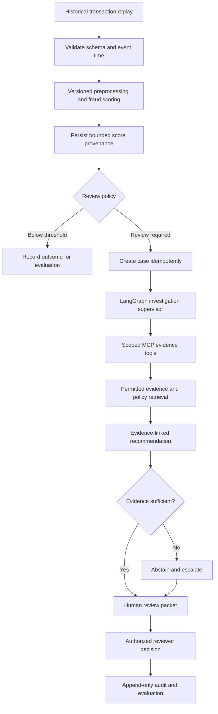

# Portfolio delivery workflow

Updated October 13, 2026. This is the execution order for the production-style
portfolio. It supersedes older planning statuses, without changing historical results.
It is a delivery plan, not a claim that the target services are implemented.

## Required final environment

The complete portfolio demonstration must run on AWS: model serving, Kubernetes,
Terraform, lifecycle pipelines, monitoring and investigation agents. Local validation
is preparation. Deploy in cost-bounded stages, capture evidence, then remove the
demonstration resources. See [current status and stack](PROJECT_STATUS_AND_STACK.md).

## Current checkpoint

| Area | Verified status |
| --- | --- |
| Data | IEEE-CIS downloaded; original ZIP uploaded to private S3; object-version pinning pending |
| Analysis | Descriptive EDA, same-split comparisons, calibration and winner subgroups completed; wider correlations sampled |
| Model | Calibrated 15-feature random forest exported to ONNX; histogram boosting won comparison but export failed |
| API | Guarded scoring, cases, score provenance, evidence references and immutable investigation submissions implemented |
| Infrastructure | Local Kubernetes deployment, API pod recovery, manual scaling and Terraform rebuild verified; cluster removed |
| AWS serving | Target (not built yet); no AWS fraud-service deployment verified |
| Agents | Tested policy library only; live LangGraph, MCP, retrieval and human-review transitions are targets |

Evidence: [analysis](FULL_EDA_COMPARISON.md), [deployment proof](DEPLOYMENT_PROOF.md),
and [build journal](BUILD_JOURNAL.md). Existing artifacts remain preserved as baselines.
The user has authorized additional IEEE-CIS model training for this portfolio.
Home Credit and Elliptic boundaries remain separate and unavailable without artifacts.

## Delivery order and completion gates

| Stage | Work to perform | Evidence required before moving on |
| --- | --- | --- |
| 1. Data and evaluation contract | Pin checksums and S3 version; join identity one-to-one without losing transactions; define event-time feature availability; freeze temporal folds, features and evaluation protocol | Duplicate/orphan checks; no future aggregates or label-derived features; training-only fitted preprocessing; reproducible dataset manifest |
| 2. Stronger candidate | Compare richer transaction/identity features and bounded boosting candidates against the existing baseline on identical folds | AP, ROC AUC, precision, recall, false-positive rate, Brier/log loss, confusion counts, subgroup sizes/errors and uncertainty; runtime/memory and reproducible configuration |
| 3. Operating policy | Fit calibration separately; choose a review threshold using validation data and a documented review capacity/cost scenario | Raw-versus-calibrated comparison; recall at fixed review rates; expected review volume; frozen threshold and calibration before audit |
| 4. Serving qualification | Export the selected candidate or document a measured fallback; version preprocessing, schema and artifact together | Offline/ONNX/API parity; unknown-category/missing-value tests; invalid-input rejection; latency under stated load; rollback to baseline |
| 5. Lifecycle and operations | Add MLflow lineage, idempotent Airflow pipelines, release gates, Prometheus metrics and Grafana dashboards locally | Retry/restart tests without duplicate effects; promotion and rollback record; metrics without raw features; working latency/error/drift alert demonstration |
| 6. Temporary AWS assessment | Review a concrete Terraform plan and cost estimate; deploy the qualified model and replay historical events | Authenticated prediction, database readiness, pod recovery, per-replica scaling checks, no-drift plan, load results, screenshots and teardown evidence |
| 7. Investigation agents | Add durable LangGraph orchestration, scoped MCP tools, permitted retrieval and authoritative review transitions | Case isolation, cited evidence, abstention, prompt-injection resistance, bounded calls/cost, checkpoint recovery and human-review tests |
| 8. Final portfolio assessment | Compare manual review with agent-assisted review on the same frozen cases; publish measured results and limitations | Review-time measurement method, reviewer corrections, citation accuracy, escalation quality, per-case cost, architecture diagram and reproducible demo instructions |

**Immediate next implementation task:** stage 1 and a richer-feature candidate
comparison in stage 2. Do not deploy the current baseline merely to label it production-ready.
Failure at a gate produces a documented finding and remediation; it does not silently
promote a weaker candidate or convert an unimplemented service into a completed task.

All previously inspected labeled periods are retrospective. New chronological folds
improve evaluation discipline but cannot make already examined data an untouched test.
Independent prospective validation remains required for any actual business deployment.
Feature availability must be stated explicitly because anonymized IEEE-CIS columns do
not establish what a real company can know at authorization time.

Review capacity and fraud-loss costs are portfolio assumptions, not business facts.
Report a range of review capacities before selecting a documented demonstration policy;
never tune the threshold using audit outcomes or promise an arbitrary accuracy target.

## Target transaction and investigation flow

This diagram is a **target flow**. Historical replay simulates arrival; it is not
a live bank feed. Low scores are not proof of legitimate transactions. Reviewer
decisions are not automatically treated as ground-truth fraud labels.

## Agent scope: reduce repetitive work

Agents may collect authorized evidence, summarize model outputs, retrieve approved
policy documents, prioritize cases and draft cited reports. Deterministic application
code owns authentication, schema checks, thresholds and policy enforcement. An LLM
must not invent model explanations or reconstruct unavailable transaction history.

Start with one supervisor and narrowly scoped tools. Add specialist agents only when
evaluation demonstrates value. Store durable checkpoints, explicit terminal states,
idempotency keys, model/prompt/tool versions and bounded tool-call/token/time budgets.
Treat retrieved text as untrusted evidence, never instructions or authorization.

Human approval remains authoritative for consequential decisions. No agent directly
blocks a transaction, freezes an account, changes a customer risk classification or
deletes an audit record. Test cross-owner access, missing evidence, fabricated citations,
tool timeouts, repeated delivery, checkpoint restart and kill-switch behavior.

Measure review time with a stated manual baseline and reviewer procedure. If only
synthetic reviewer tests exist, label the results synthetic; do not claim measured
human labor savings. Keep an agent-disabled path for comparison and rollback.

## AWS budget and teardown contract

The observed October 13 estimated credit balance was $158.94. That is the user's
maximum credit envelope, not a target spend or a guaranteed current balance.
Recheck credit eligibility, expiry, delayed billing and existing resources before launch.
Do not upgrade the account plan, buy commitments or incur uncovered charges implicitly.

Prepare an itemized estimate and TTL for each exercise. Choose between self-managed
Kubernetes on EC2 and EKS using the actual requirements and costs; identify the chosen
option accurately. Avoid duplicate orchestration and unnecessary managed services.
Use short-lived authentication, private access, narrow IAM, encrypted storage and
resource tags identifying the demonstration. Verify teardown before creating resources.

Capture application results and infrastructure state, then destroy only resources
created for the demonstration. Verify instances, disks, snapshots, addresses, load
balancers, clusters, registries and log retention rather than assuming an empty pod
list means billing stopped. Preserve the original dataset, baseline models and evidence.
Budget alerts do not enforce a spending cap; stopping compute does not remove storage.

## Evidence and release checklist

- Save private raw results, predictions, state and screenshots under ignored artifacts/.
- Publish aggregate tables, sanitized screenshots, scripts and limitations in GitHub.
- Capture deployed health, predictions, recovery, scaling, metrics and cleanup at the
  time of execution; do not manufacture retrospective screenshots of running resources.
- Keep credentials, account details, raw records and sensitive evidence out of public images.
- Preserve the existing CI tests. Add targeted tests with each executable feature;
  introduce AWS deployment jobs only when authentication, cost controls and teardown exist.
- Update this status table and the journal only after the corresponding tests run.
- Keep pull requests reviewable; do not merge or enable automatic cloud deployment
  merely because a planning document was updated.
