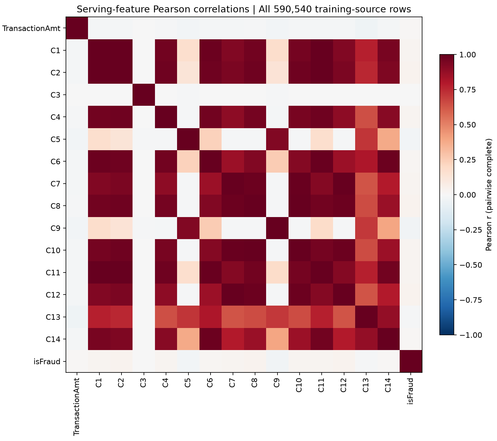

# Expanded IEEE CIS analysis and model comparison

Completed October 13, 2026. This is an educational retrospective analysis, not production validation. Raw outputs and prediction rows remain in ignored artifacts/ieee_cis/full-analysis-v1.

## Scope and limitations

Full-source transaction and identity descriptive statistics, missingness, cardinalities, category fraud rates, and key checks were computed. All 15 serving-feature correlations use all 590540 rows. The wider numeric correlation matrix uses a reproducible 50000-row sample; it is not an all-row calculation. Unlabeled competition transactions were checked for duplicate/disjoint IDs and descriptive feature distributions. Identity test schema normalization and prospective drift tests are future work.

The final 20% was previously evaluated by baseline v1. It is called an audit holdout and is not a pristine final test. No protected demographic attributes were available; subgroup results below describe business categories only. Groups below 100 rows are omitted.

## Temporal partitions

| Partition | Rows | Use |
| --- | ---: | --- |
| train | 354324 | Fit all candidate models |
| selection | 59054 | Choose highest average precision |
| calibration | 59054 | Fit sigmoid calibrators |
| audit_holdout | 118108 | Report final retrospective results |

All models use TransactionAmt and C1 through C14, with fixed -999 blank encoding. Logistic regression scales inputs using training-only statistics. No threshold tuning was performed.

## Model selection period

| Model | ROC AUC | Average precision | Fit seconds |
| --- | ---: | ---: | ---: |
| logistic | 0.7461 | 0.2570 | 1.7 |
| random_forest | 0.8729 | 0.4906 | 5.6 |
| hist_gradient_boosting | 0.8790 | 0.5005 | 3.3 |

Selected by selection-period average precision: **hist_gradient_boosting**.

## Audit comparison before and after calibration

| Model | Output | ROC AUC | AP | Brier | Log loss | Precision | Recall | FPR |
| --- | --- | ---: | ---: | ---: | ---: | ---: | ---: | ---: |
| logistic | raw | 0.7093 | 0.1627 | 0.03174 | 0.14396 | 0.739 | 0.037 | 0.0005 |
| logistic | sigmoid | 0.7093 | 0.1627 | 0.03176 | 0.14350 | 0.769 | 0.037 | 0.0004 |
| random_forest | raw | 0.8357 | 0.4021 | 0.02532 | 0.10894 | 0.799 | 0.242 | 0.0022 |
| random_forest | sigmoid | 0.8357 | 0.4021 | 0.02542 | 0.10916 | 0.749 | 0.263 | 0.0031 |
| hist_gradient_boosting | raw | 0.8395 | 0.4065 | 0.02535 | 0.10817 | 0.741 | 0.261 | 0.0033 |
| hist_gradient_boosting | sigmoid | 0.8395 | 0.4065 | 0.02537 | 0.10824 | 0.739 | 0.261 | 0.0033 |
| constant_prior | raw | 0.5000 | 0.0344 | 0.03323 | 0.14975 | undefined | 0.000 | 0.0000 |

Precision, recall, and FPR use threshold 0.5. Smaller Brier/log loss is better. Calibration does not necessarily improve every model or every future period. AP is average precision, not trapezoidal PR-AUC.

## Subgroup analysis of calibrated selection winner

| Dimension | Group | Rows | Prevalence | AP | Recall | FPR | Brier |
| --- | --- | ---: | ---: | ---: | ---: | ---: | ---: |
| ProductCD | C | 12109 | 0.1335 | 0.7024 | 0.5201 | 0.0233 | 0.0668 |
| ProductCD | H | 3333 | 0.0591 | 0.4338 | 0.2640 | 0.0070 | 0.0433 |
| ProductCD | R | 5496 | 0.0468 | 0.5717 | 0.4475 | 0.0052 | 0.0263 |
| ProductCD | S | 3501 | 0.0523 | 0.3605 | 0.2131 | 0.0015 | 0.0404 |
| ProductCD | W | 93669 | 0.0193 | 0.0783 | 0.0077 | 0.0008 | 0.0188 |
| card4 | american express | 1126 | 0.0293 | 0.3049 | 0.2121 | 0.0046 | 0.0246 |
| card4 | discover | 1257 | 0.0899 | 0.4510 | 0.1150 | 0.0026 | 0.0699 |
| card4 | mastercard | 38355 | 0.0321 | 0.4697 | 0.3301 | 0.0037 | 0.0222 |
| card4 | visa | 76626 | 0.0349 | 0.3822 | 0.2342 | 0.0030 | 0.0264 |
| card4 | nan | 744 | 0.0202 | 0.6912 | 0.6000 | 0.0055 | 0.0116 |
| card6 | credit | 27270 | 0.0646 | 0.4959 | 0.3231 | 0.0070 | 0.0432 |
| card6 | debit | 90095 | 0.0254 | 0.3396 | 0.2111 | 0.0022 | 0.0201 |
| card6 | nan | 743 | 0.0202 | 0.6914 | 0.6000 | 0.0055 | 0.0116 |
| DeviceType | desktop | 13620 | 0.0800 | 0.6870 | 0.5142 | 0.0101 | 0.0403 |
| DeviceType | missing | 94936 | 0.0198 | 0.0966 | 0.0218 | 0.0011 | 0.0191 |
| DeviceType | mobile | 9552 | 0.1143 | 0.6107 | 0.4212 | 0.0173 | 0.0663 |
| identity_present | False | 94339 | 0.0196 | 0.0909 | 0.0179 | 0.0011 | 0.0189 |
| identity_present | True | 23769 | 0.0934 | 0.6405 | 0.4633 | 0.0127 | 0.0510 |

These are descriptive differences, not causal findings or fairness certification. Small positive-class counts make recall unstable even when a group has more than 100 rows.

## Calibration reliability tables

| Model | Output | Bin lower bound | Rows | Mean prediction | Observed fraud rate |
| --- | --- | ---: | ---: | ---: | ---: |
| logistic | raw | 0.0 | 117442 | 0.0320 | 0.0323 |
| logistic | raw | 0.1 | 348 | 0.1320 | 0.2155 |
| logistic | raw | 0.2 | 57 | 0.2479 | 0.4912 |
| logistic | raw | 0.3 | 29 | 0.3517 | 0.1034 |
| logistic | raw | 0.4 | 29 | 0.4384 | 0.3448 |
| logistic | raw | 0.5 | 10 | 0.5488 | 0.1000 |
| logistic | raw | 0.6 | 33 | 0.6515 | 0.3636 |
| logistic | raw | 0.7 | 15 | 0.7529 | 0.2667 |
| logistic | raw | 0.8 | 16 | 0.8583 | 0.8750 |
| logistic | raw | 0.9 | 129 | 0.9898 | 0.9225 |
| logistic | sigmoid | 0.0 | 117515 | 0.0312 | 0.0325 |
| logistic | sigmoid | 0.1 | 293 | 0.1287 | 0.2253 |
| logistic | sigmoid | 0.2 | 46 | 0.2392 | 0.3913 |
| logistic | sigmoid | 0.3 | 44 | 0.3446 | 0.1818 |
| logistic | sigmoid | 0.4 | 15 | 0.4481 | 0.3333 |
| logistic | sigmoid | 0.5 | 23 | 0.5582 | 0.3913 |
| logistic | sigmoid | 0.6 | 20 | 0.6411 | 0.2000 |
| logistic | sigmoid | 0.7 | 11 | 0.7439 | 0.6364 |
| logistic | sigmoid | 0.8 | 21 | 0.8431 | 0.9048 |
| logistic | sigmoid | 0.9 | 120 | 0.9922 | 0.9250 |
| random_forest | raw | 0.0 | 112059 | 0.0226 | 0.0199 |
| random_forest | raw | 0.1 | 3292 | 0.1466 | 0.1170 |
| random_forest | raw | 0.2 | 970 | 0.2438 | 0.2887 |
| random_forest | raw | 0.3 | 356 | 0.3440 | 0.2809 |
| random_forest | raw | 0.4 | 199 | 0.4421 | 0.4322 |
| random_forest | raw | 0.5 | 176 | 0.5473 | 0.7216 |
| random_forest | raw | 0.6 | 261 | 0.6552 | 0.6322 |
| random_forest | raw | 0.7 | 293 | 0.7519 | 0.7782 |
| random_forest | raw | 0.8 | 295 | 0.8471 | 0.9186 |
| random_forest | raw | 0.9 | 207 | 0.9393 | 0.9324 |
| random_forest | sigmoid | 0.0 | 110361 | 0.0196 | 0.0192 |
| random_forest | sigmoid | 0.1 | 3818 | 0.1271 | 0.0749 |
| random_forest | sigmoid | 0.2 | 1683 | 0.2349 | 0.1990 |
| random_forest | sigmoid | 0.3 | 572 | 0.3447 | 0.2902 |
| random_forest | sigmoid | 0.4 | 246 | 0.4475 | 0.3496 |
| random_forest | sigmoid | 0.5 | 184 | 0.5436 | 0.4185 |
| random_forest | sigmoid | 0.6 | 167 | 0.6530 | 0.7246 |
| random_forest | sigmoid | 0.7 | 241 | 0.7569 | 0.6639 |
| random_forest | sigmoid | 0.8 | 372 | 0.8496 | 0.7446 |
| random_forest | sigmoid | 0.9 | 464 | 0.9455 | 0.9353 |
| hist_gradient_boosting | raw | 0.0 | 111650 | 0.0195 | 0.0191 |
| hist_gradient_boosting | raw | 0.1 | 3659 | 0.1454 | 0.1369 |
| hist_gradient_boosting | raw | 0.2 | 743 | 0.2458 | 0.2382 |
| hist_gradient_boosting | raw | 0.3 | 454 | 0.3381 | 0.2974 |
| hist_gradient_boosting | raw | 0.4 | 171 | 0.4431 | 0.3392 |
| hist_gradient_boosting | raw | 0.5 | 160 | 0.5499 | 0.4250 |
| hist_gradient_boosting | raw | 0.6 | 175 | 0.6527 | 0.5771 |
| hist_gradient_boosting | raw | 0.7 | 149 | 0.7460 | 0.5302 |
| hist_gradient_boosting | raw | 0.8 | 250 | 0.8523 | 0.6960 |
| hist_gradient_boosting | raw | 0.9 | 697 | 0.9446 | 0.9154 |
| hist_gradient_boosting | sigmoid | 0.0 | 111451 | 0.0201 | 0.0189 |
| hist_gradient_boosting | sigmoid | 0.1 | 3752 | 0.1454 | 0.1333 |
| hist_gradient_boosting | sigmoid | 0.2 | 788 | 0.2411 | 0.2348 |
| hist_gradient_boosting | sigmoid | 0.3 | 501 | 0.3380 | 0.3014 |
| hist_gradient_boosting | sigmoid | 0.4 | 181 | 0.4454 | 0.3260 |
| hist_gradient_boosting | sigmoid | 0.5 | 154 | 0.5521 | 0.4221 |
| hist_gradient_boosting | sigmoid | 0.6 | 179 | 0.6539 | 0.5587 |
| hist_gradient_boosting | sigmoid | 0.7 | 153 | 0.7481 | 0.5490 |
| hist_gradient_boosting | sigmoid | 0.8 | 243 | 0.8530 | 0.6872 |
| hist_gradient_boosting | sigmoid | 0.9 | 706 | 0.9450 | 0.9136 |

## Correlation findings

Pearson correlations use pairwise complete observations; correlations are associations, not causes. Missingness patterns and anonymized feature definitions constrain interpretation.

| Feature pair | Pearson correlation |
| --- | ---: |
| C12 and C7 | 0.9995 |
| C10 and C8 | 0.9970 |
| C1 and C11 | 0.9965 |
| C1 and C2 | 0.9951 |
| C11 and C2 | 0.9939 |
| C11 and C6 | 0.9911 |
| C10 and C7 | 0.9851 |
| C14 and C6 | 0.9842 |
| C10 and C12 | 0.9838 |
| C12 and C8 | 0.9830 |
| C7 and C8 | 0.9830 |
| C1 and C6 | 0.9822 |
| C2 and C8 | 0.9759 |
| C2 and C6 | 0.9748 |
| C11 and C4 | 0.9745 |
| C2 and C4 | 0.9721 |
| C10 and C2 | 0.9706 |
| C1 and C4 | 0.9678 |
| C1 and C8 | 0.9677 |
| C11 and C8 | 0.9627 |

## Deployment model decision

Histogram gradient boosting won statistical selection but the installed skl2onnx converter failed on a boolean tree attribute. Its failure is preserved in the work record; it was not replaced as the reported winner. The calibrated random forest is the deployable fallback, version ieee-rf15-sigmoid-v2. Its ONNX graph includes sigmoid calibration, and parity was checked on all audit rows. Ten protected FastAPI golden requests passed. No claim is made that the fallback is the best candidate.

## Saved reproducible outputs

scripts/analyze_ieee_full.py creates descriptive tables, quality tables, correlations, category summaries, reliability/subgroup results and private predictions. scripts/export_selected_model.py exports the documented random-forest fallback using the recorded calibration parameters. Dependency versions are locked in uv.lock. No raw rows or binaries belong in Git.

## Figures




## Reproduce

Run from the repository root with the approved IEEE-CIS CSVs in data/raw/ieee_cis.
Output directories must not already exist; archive an earlier run before repeating.
```powershell
uv sync --frozen --extra training --extra onnx-cpu
uv run python scripts/analyze_ieee_full.py --raw data/raw/ieee_cis --output artifacts/ieee_cis/full-analysis-v1
uv run python scripts/export_selected_model.py
uv run python scripts/verify_model_api.py --model-dir artifacts/ieee_cis/model-v2
uv run python scripts/report_ieee_analysis.py
uv run python scripts/plot_ieee_analysis.py
```

The export and report helpers use the documented default folders. Raw source, predictions and model files stay private. The analysis also records the source SHA-256.
The old v1 baseline used a larger training split; its metrics are not a fair same-split comparison against these three candidates.

## Remaining model work

Validate the deployed fallback by subgroup independently; current subgroup tables describe the statistical winner. Resolve the histogram-model ONNX converter failure, evaluate a locked prospective period, add uncertainty intervals, select thresholds using business costs on validation data, and monitor drift before any real use.
Agent investigations, MLflow/Airflow and monitoring remain Target (not built yet).
