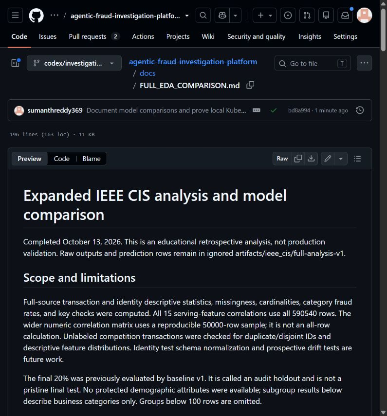

# Milestone evidence gallery

Updated October 16, 2026. Screenshots show what was visible when captured;
automated results and execution logs establish whether a test passed.

## Published analysis

Actual browser screenshot of the published analysis report. This proves publication,
not a running AWS service. Raw datasets and credentials are not included.

## Model comparison and correlations

The following are generated scientific figures, not application screenshots.
See [the full report](FULL_EDA_COMPARISON.md) for split definitions and limitations.

## Capture checklist for subsequent execution

| Level | Evidence to capture | Current status |
| --- | --- | --- |
| Richer model | Training completion, comparison table and qualification results | Completed locally; [measured results](RICHER_MODEL_CANDIDATE.md) |
| Local infrastructure | Readiness, pod replacement, replica scoring and Terraform rebuild | Execution proof saved; no historical running-stack screenshot claimed |
| AWS infrastructure | Tagged resources, deployment health, Terraform plan/apply results | Private control plane created; worker launch failed; environment removed |
| AWS model API | Authenticated smoke-test summary without tokens or raw feature payloads | Not deployed |
| MLflow/Airflow | Versioned model run and successful scheduled pipeline/recovery | Target (not built yet) |
| Prometheus/Grafana | Measured latency/error dashboard and triggered alert | Target (not built yet) |
| Agents | Evidence-linked case report, abstention, human review and checkpoint recovery | Target (not built yet) |
| AWS teardown | Deleted demonstration resources and residual-resource inventory | [25 resources removed; cleanup checks passed](AWS_EXECUTION_20261015.md) |

Save original screenshots locally under ignored artifacts/milestones. Publish only
reviewed images with account identifiers, credentials, raw rows and sensitive evidence
excluded. Do not substitute diagrams or local screenshots for AWS runtime evidence.
