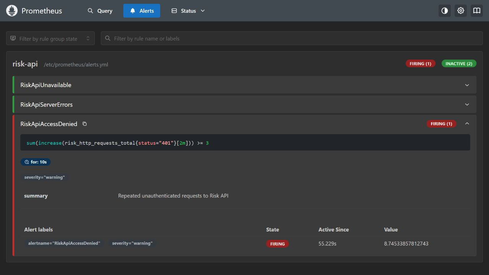

# API monitoring

The API exposes Prometheus request counts and latency histograms through `/metrics`.
Access is disabled by default. Set `RISK_METRICS_ENABLED=true` and a separate
`RISK_METRICS_TOKEN` of at least 32 characters to enable authenticated scraping.
The metrics token does not authorize case or scoring requests.

Labels contain the registered route template, a bounded HTTP method, and response
status. Unknown paths share the `unmatched` label. Case identifiers, query strings,
feature values, request bodies and credentials are excluded. Each application
instance has its own registry; scrape each replica separately. Counter resets on
restart are expected. These metrics do not measure model drift or prediction quality.

## Reproduce locally

With Docker running and development dependencies installed:

```powershell
uv run python scripts/demo_observability.py
```

The script builds the API and runs digest-pinned Prometheus and Grafana images.
Ports are bound to loopback only. Generated credentials and Compose configuration
are stored under ignored `artifacts/observability/`; do not publish that directory.
The demo does not load a fraud model or start a database.

The assessment checks authenticated scraping, generates synthetic unauthorized
requests, waits for `RiskApiAccessDenied` to fire, checks latency samples, and reads
back the four provisioned dashboard panels. It removes the containers and volumes
in a `finally` block and writes aggregate outcomes to `results.json`.

The dashboard shows request rate, p95 latency, server errors and scrape health.
The October 17 local assessment passed all four checks and confirmed removal of
the demonstration containers. The first alert replay exposed a missing initial
counter sample; the corrected replay establishes that sample before the test burst.
Rules also cover unavailable targets and server errors. Alertmanager notification
delivery, OpenTelemetry tracing, drift monitoring and AWS installation remain
Target (not built yet). The rule demonstration is not proof of email delivery.



Implementation follows the [Prometheus Python client histogram API](https://prometheus.github.io/client_python/instrumenting/histogram/).
