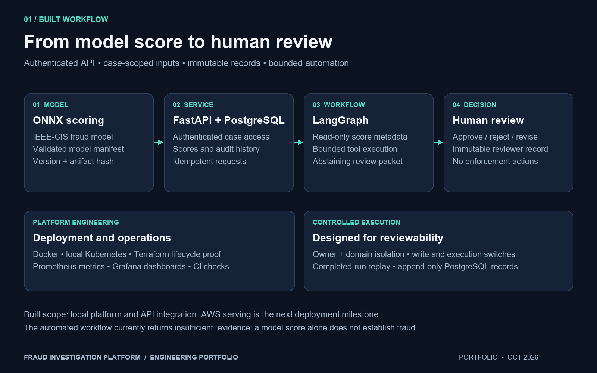
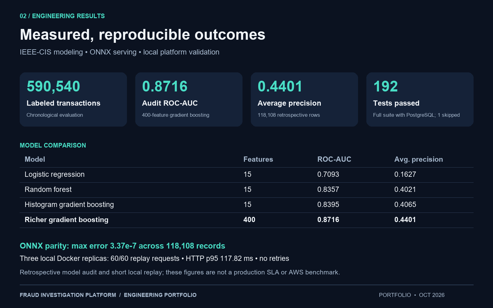
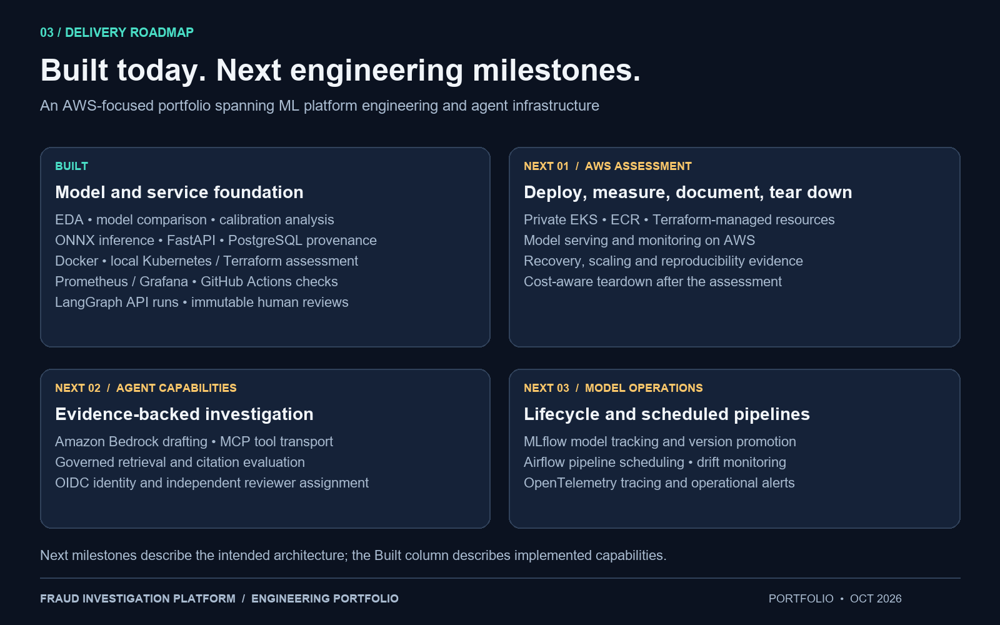

# Agentic Fraud Investigation Platform

**ML Platform Engineering · Model Serving · Bounded Agent Workflows**

Built a fraud scoring and investigation platform that turns model predictions into
auditable case records and human-review packets. The project combines chronological
model evaluation, portable ONNX inference, guarded APIs, database integrity, local
Kubernetes operations, and observable services.

## Workflow

[Download workflow PNG](images/portfolio/01-workflow.png)

FastAPI authenticates the operator and checks case ownership and domain access.
ONNX scores retain model identity and artifact provenance. The LangGraph API workflow
reads selected score metadata and creates an abstaining review packet. A configured
reviewer records a separate immutable decision; the workflow performs no enforcement.

## Results

[Download results PNG](images/portfolio/02-results.png)

- Analyzed **590,540 transactions** and compared logistic regression, random forest,
  and histogram gradient boosting using chronological evaluation periods.
- Qualified a **400-feature model** with **0.8716 ROC-AUC** and **0.4401 average precision**
  on **118,108 retrospective audit records**.
- Checked ONNX parity across those records with maximum absolute error **3.37e-7**.
- Completed **60/60** requests across three local Docker replicas with no retries;
  measured HTTP **p95 117.82 ms** during the bounded replay.
- Passed **192 tests**, with **1 skipped**, including PostgreSQL migration parity,
  concurrent idempotency, atomic audits, and append-only protection.

The audit period was previously examined. The short laptop replay is a reproducible
engineering assessment, not a sustained production capacity measurement. Local Kubernetes
recovery and scaling evidence used the earlier 15-feature model; the richer model has
separate ONNX and Docker serving evidence.

## Built capabilities and next milestones

[Download roadmap PNG](images/portfolio/03-roadmap.png)

| Built capabilities | Next milestones |
| --- | --- |
| EDA, comparisons, calibration and subgroup analysis | Scheduled MLflow and Airflow lifecycle workflows |
| Guarded FastAPI and ONNX serving | AWS EKS application deployment and assessment |
| PostgreSQL provenance and immutable reviews | Multi-user OIDC identity and reviewer assignment |
| LangGraph execution and completed-run replay | Bedrock drafting and MCP tool transport |
| Local case-scoped lexical retrieval | Governed external retrieval and citation evaluation |
| Local Kubernetes / Terraform lifecycle proof | AWS recovery, scaling, reproducibility and teardown evidence |
| Prometheus metrics and Grafana dashboard | OpenTelemetry tracing and operational alert delivery |

## Engineering evidence

- [EDA and model comparison](FULL_EDA_COMPARISON.md)
- [Model qualification and thresholds](RICHER_MODEL_QUALIFICATION.md)
- [ONNX serving qualification](RICHER_MODEL_SERVING.md)
- [Local three-replica results](REPLICA_REPLAY_RESULTS.md)
- [Investigation API and review semantics](INVESTIGATION_API.md)
- [Local retrieval implementation](LOCAL_EVIDENCE_RETRIEVAL.md)
- [Monitoring demonstration](OBSERVABILITY.md)

These images are architecture and results graphics, not screenshots of deployed services.
Their source is [the rendering script](../scripts/render_portfolio_images.py).
All three PNGs are 1600 × 1000 and can be reused in a GitHub profile, portfolio, or presentation.
