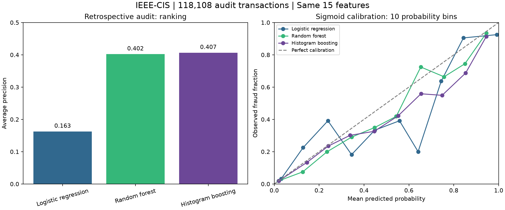

# Project status, models and technology stack

October 15 AWS update: the private EKS control plane was created, but worker launch
failed on account Free Tier eligibility. All 25 managed demo resources were then
destroyed and cleanup checks passed. AWS application deployment remains incomplete.
See [execution and cleanup evidence](AWS_EXECUTION_20261015.md) and
[verified portfolio metrics](PORTFOLIO_METRICS.md).

Updated October 15, 2026. Portfolio project: production-style engineering with
historical IEEE-CIS replay, not a live banking integration or approved production model.

## Completed model work

All candidates below use the same 15 features and chronological 60/10/10/20
training/selection/calibration/audit partitions. The audit contains 118,108 rows
and was previously examined. AP means average precision. Threshold metrics use 0.5.

| Candidate | Audit ROC AUC | Audit AP | Brier | Precision | Recall | Disposition |
| --- | ---: | ---: | ---: | ---: | ---: | --- |
| Logistic regression, raw | 0.7093 | 0.1627 | 0.03174 | 0.739 | 0.037 | Comparison candidate |
| Random forest, raw | 0.8357 | 0.4021 | 0.02532 | 0.799 | 0.242 | Comparison candidate |
| Random forest, sigmoid | 0.8357 | 0.4021 | 0.02542 | 0.749 | 0.263 | ONNX deployment fallback |
| Histogram boosting, raw | 0.8395 | 0.4065 | 0.02535 | 0.741 | 0.261 | Selection-period winner; ONNX conversion failed |
| Histogram boosting, sigmoid | 0.8395 | 0.4065 | 0.02537 | 0.739 | 0.261 | Calibration comparison |
| Constant prior | 0.5000 | 0.0344 | 0.03323 | Undefined | 0.000 | Reference baseline |

The selection winner was chosen on the selection period, not this audit table.
Calibration did not improve random-forest audit Brier score. The local Kubernetes proof used
`ieee-rf15-sigmoid-v2`. Earlier v1 used a different training budget and is not
included as a same-split competitor. A [400-feature research candidate](RICHER_MODEL_CANDIDATE.md) has now been trained;
its audit AP is 0.4401. The 400-feature model is now exported as
`ieee-hgb400-raw-v3` and qualified through local ONNX/API/container and database
replay checks. AWS deployment remains pending; see the linked qualification reports below.

[Full comparisons, calibration bins and subgroup tables](FULL_EDA_COMPARISON.md)
include the omitted logistic calibrated variant and evaluation caveats.
Descriptive statistics cover full training sources; serving-feature correlations
cover all 590,540 rows, while wider numeric correlations use a 50,000-row sample.

## Executable code and evidence

| Work | Repository entry point | Status |
| --- | --- | --- |
| Profiling and source checks | [profile_ieee_cis.py](../scripts/profile_ieee_cis.py) | Executed |
| Model comparison and EDA | [analyze_ieee_full.py](../scripts/analyze_ieee_full.py) | Executed |
| ONNX fallback export | [export_selected_model.py](../scripts/export_selected_model.py) | Export verified against all audit rows |
| Protected API verification | [verify_model_api.py](../scripts/verify_model_api.py) | Golden predictions and rejection checks passed |
| Tables and charts | [report_ieee_analysis.py](../scripts/report_ieee_analysis.py), [plot_ieee_analysis.py](../scripts/plot_ieee_analysis.py) | Generated and published |
| API and policy code | [risk_platform](../src/risk_platform/) | Implemented; policy is not a live agent runtime |
| Local infrastructure | [Terraform](../infra/local/), [proof script](../scripts/prove_local_cluster.py) | Deployment, recovery, scaling and rebuild verified |
| Automated checks | [CI workflow](../.github/workflows/ci.yml), [tests](../tests/) | Existing Python/security/PostgreSQL/ONNX checks |

The local infrastructure exercise passed 60 golden HTTP predictions, including
each of three replicas and the rebuilt deployment. The disposable cluster was removed.
See [deployment evidence and limitations](DEPLOYMENT_PROOF.md). No AWS fraud serving
deployment, live event pipeline or operational agent has been verified.

## Technology stack

| Layer | Implemented or verified locally | AWS completion target (not built yet) |
| --- | --- | --- |
| Data and analysis | IEEE-CIS, Python, pandas, NumPy, Matplotlib; original ZIP uploaded to private S3 | Version-pinned S3 data/artifact manifests and scheduled ingestion |
| Modeling | scikit-learn, sigmoid calibration, skl2onnx, ONNX Runtime | Qualified richer-feature model and versioned promotion/rollback |
| Service | FastAPI, Pydantic, Uvicorn, bearer authentication and guardrails | Authenticated private cloud serving and historical event replay |
| Persistence | PostgreSQL, SQLAlchemy, psycopg, Alembic; append-only audit/provenance | Cloud database persistence, recovery and retention controls |
| Containers | Docker; kind/Kubernetes local proof; kubectl | Kubernetes on AWS; topology selected through a costed infrastructure plan |
| Infrastructure and releases | Terraform local module and provider lock; GitHub Actions; uv lock | AWS Terraform, short-lived deployment authentication, controlled releases and teardown |
| Model lifecycle | Reproducible scripts and versioned manifests | MLflow tracking/registry and Airflow scheduled pipelines on AWS |
| Monitoring | Health probes and structured service logs | Prometheus/Grafana dashboards, CloudWatch operational evidence and tested alerts |
| Investigation | Case/evidence/investigation records and bounded policy library | LangGraph, scoped MCP tools, approved retrieval, model-provider integration and human-review transitions |

Exact installed Python dependencies are recorded in [uv.lock](../uv.lock).
Do not interpret this stack table as proof of unimplemented AWS services.

## Upcoming delivery and AWS scope

The user requires the complete portfolio demonstration on AWS, including model
serving, Kubernetes, Terraform, lifecycle pipelines, monitoring and investigation
agents. Local checks remain preparation, not the final cloud demonstration.

1. Freeze data availability and chronological evaluation rules; train and compare
   richer-feature candidates without replacing the preserved baseline.
2. Validate calibration, review thresholds, subgroups, latency and ONNX/API parity.
3. Implement and test lifecycle pipelines, monitoring and release controls.
4. Deploy the complete demonstration to AWS in bounded stages; replay historical
   transactions and prove predictions, recovery, scaling and reproducibility.
5. Add durable, scoped investigation agents to reduce repetitive evidence gathering
   and report drafting. Keep consequential decisions under human approval.
6. Capture sanitized screenshots, tables and test evidence, then remove demonstration
   compute, networking, storage and supporting resources; verify residual charges.

[Delivery workflow](DELIVERY_WORKFLOW.md) defines the detailed completion gates.
Upcoming components above are a backlog, not generated placeholder code presented
as working software. Existing executable code is linked separately above.

The last observed estimated AWS credit balance was $158.94 on October 13. Recheck
it before deployment; it is a ceiling, not a spending target or a guaranteed balance.
Deletion stops future usage but does not cancel charges already incurred. Preserve
the original dataset and evidence; identify any retained S3 storage explicitly.

## Publication boundary

GitHub contains source, aggregate comparisons, charts, workflow and limitations.
Raw data, model binaries, golden feature payloads, credentials and Terraform state
remain excluded. This update publishes model documentation, not model binaries to
GitHub or S3. A private, versioned artifact upload is part of the AWS deployment work.

Calibration, validation-defined review scenarios and business-subgroup evaluation are now recorded in [the qualification report](RICHER_MODEL_QUALIFICATION.md). This supersedes earlier pending labels for those analyses; serving qualification remains pending.

Update: [richer-model ONNX export and local API qualification](RICHER_MODEL_SERVING.md) now pass. This supersedes the earlier export-pending status. Cloud deployment and production approval remain pending.

[Container concurrency assessment](RICHER_CONTAINER_ASSESSMENT.md): v3 golden predictions pass, but a four-client burst produced 22 capacity-related 503 responses out of 40 requests. Multi-replica load acceptance remains pending.

[Three-replica bounded replay](REPLICA_REPLAY_RESULTS.md) subsequently passed 60/60 requests with zero retries and exact parity. This is local Docker replay, not AWS or Kubernetes load-balancer validation.

[Versioned feature builder](IEEE_FEATURE_CONTRACT.md) implemented and matched against all ten real golden input vectors.

[Database-backed replay](DATABASE_REPLAY_RESULTS.md) now passes ten golden predictions,
duplicate delivery after an API restart and changed-payload rejection on local
PostgreSQL 17. AWS deployment remains pending.
